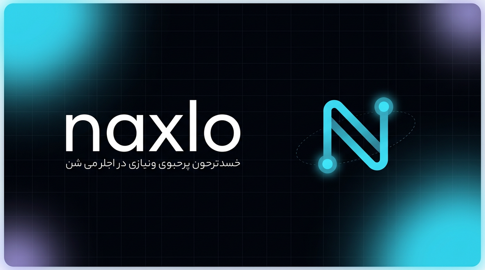

<div align="center">



# naxlo

**کلاینت فارسی‌زبان VLESS برای ویندوز، لینوکس و مک — سبک، تاریک، با نسخهٔ Rust و حالت TUN اختیاری**

*A Persian-first VLESS client for Windows, Linux, macOS and Android — lean, near-black, with a Rust edition and an optional TUN mode.*

**فارسی** · [English](#-english)

Electron + React (ویندوز) • **Rust + Tauri (ویندوز/لینوکس/مک)** • Xray-core در حالت پروکسی محلی

[](https://github.com/Manixpcshot/Naxlo-tun/releases)
[](LICENSE)
[](https://github.com/Manixpcshot/Naxlo-tun/releases)
[](https://github.com/Manixpcshot/Naxlo-tun/actions)

</div>

---

ناکسلو یک کارگیر (کلاینت) دسکتاپ است: لینک اشتراک را می‌گیرید، فایل TXT را دریافت و Base64 آن را
بازگشایی می‌کند، کانفیگ‌های VLESS را در یک فهرست زیبا نشان می‌دهد و با یک کلیک، هستهٔ Xray را در **حالت پروکسی
محلی** (SOCKS5 + HTTP روی `127.0.0.1`) اجرا می‌کند — بدون درایور و بدون دسترسی مدیر. از v1.6.0 یک **حالت TUN
اختیاری** هم وجود دارد: تونل کل‌سیستمی با اینباند TUN داخلی خود Xray و درایور رسمی Wintun (یک‌بار تأیید UAC)، برای
برنامه‌هایی که پروکسی ویندوز را نادیده می‌گیرند. از **v1.7.0** دو نسخهٔ دسکتاپ منتشر می‌شود: نسخهٔ **Electron**
(ویندوز، با تمام امکانات) و نسخهٔ **Rust/Tauri** (ویندوز + **لینوکس** + **مک**) با همان رابط کاربری React.

## ✨ ویژگی‌ها

| بخش | توضیح |
| --- | --- |
| 🔑 اشتراک | دریافت فایل TXT، بازگشایی Base64، تجزیهٔ `vless://` و `trojan://` و `vmess://` |
| 📁 فایل | وارد کردن کانفیگ از فایل‌های `txt/json/conf/sub` و **زیپ رمزدار** (پشتیبانی ZipCrypto با دریافت رمز از کاربر؛ در اندروید ZipCrypto و AES) |
| 🖥️ سرورها | فهرست زنده با جست‌وجو، فیلتر (REALITY/WS/gRPC)، تست تأخیر گروهی و مرتب‌سازی بر اساس سرعت |
| ⚡ اتصال | اجرای Xray با اینباندهای لوکال، تست واقعی عبور ترافیک، نمایش وضعیت، آی‌پی خروجی و مدت اتصال |
| 🧩 پروکسی سیستم | تنظیم خودکار پروکسی ویندوز (WinINET) و بازگردانی دقیق تنظیمات قبلی هنگام قطع |
| 🌐 حالت TUN | تونل اختیاری کل‌سیستمی با اینباند TUN داخلی Xray و درایور رسمی Wintun (پین SHA-256 + یک‌بار تأیید UAC) — حتی برنامه‌هایی که پروکسی را نادیده می‌گیرند |
| 🚪 خروج ایمن | هشدار سه‌گزینه‌ای هنگام بستن برنامه در حالت اتصال: «خاموش کن و ببند»، «متصل بمان و ببند» یا «لغو» (دسکتاپ و اندروید) |
| 🧠 هسته | دانلود خودکار Xray-core از مخزن رسمی + اعتبارسنجی SHA-512 + امکان انتخاب فایل دلخواه |
| 🔒 حریم خصوصی | خزانهٔ رمزنگاری‌شده (DPAPI)، نمایش پوشیدهٔ همهٔ مقادیر حساس، و **عدم ثبت هرگز** آن‌ها در لاگ |
| 📊 آمار | صفحهٔ آمار مصرف: کارت **امروز** (دقیقه‌ها، نشست‌ها، بهترین/میانگین سرعت و تغییر نسبت به دیروز)، نمودار ۱۴ روزهٔ مدت اتصال، سرورهای پراستفاده با پرچم کشورها و تاریخچهٔ تست سرعت — داخل همان خزانهٔ رمزنگاری‌شده |
| 🧰 ابزارها | صفحهٔ ابزارها: اعتبارسنج کانفیگ کاملاً local (vless/vmess/trojan/ss با فیلدهای پوشیده) و ساخت **QR** از لینک یا از یکی از سرورهای خودتان — بدون آپلود هیچ چیز |
| 🗣️ زبان | سه زبان کامل — **فارسی** (پیش‌فرض)، **انگلیسی** و **ترکی** — در اپ، نسخهٔ Rust، اندروید و وب‌سایت. از v1.16.0 نخستین اجرا زبان خود سیستم‌عامل را دنبال می‌کند، دیالوگ‌های بومی انتخاب فایل هم به زبان انتخابی شما هستند؛ فارسی فالبک دیگر زبان‌هاست |
| 🌙 طراحی | تم مشکی با یک رنگ تأکیدی، **پوستهٔ روز (روشن) اختیاری** در اپ/سایت/اندروید، رابط کاملاً راست‌چین با قلم وزیرمتن و انیمیشن‌های نرم |

## 🧭 ناکسلو چگونه کار می‌کند؟

```
لینک اشتراک ──► دریافت TXT ──► بازگشایی Base64 ──► تجزیهٔ لینک‌ها (VLESS/…)
        │                                                     │
        ▼                                                     ▼
 خزانهٔ رمزنگاری‌شده ◄────────────────────────────── فهرست سرورها (نمایش پوشیده)
        │
        ▼
 انتخاب سرور ──► ساخت کانفیگ Xray ──► اجرای xray.exe (فرایند فرزند)
                                          │
                اینباند SOCKS5 :10808 ◄───┤
                اینباند HTTP   :10809 ◄───┘
                                          │
        (اختیاری) پروکسی سیستم ویندوز ◄───┘  ──► تست عبور ترافیک ──► وضعیت «متصل»
```

- **حالت پیش‌فرض (پروکسی):** ترافیک از دو اینباند لوکال عبور می‌کند؛ یا با پروکسی خودکار ویندوز، یا با تنظیم دستی
  هر برنامه روی آدرسهای بالا — بدون درایور و بدون دسترسی مدیر.
- **حالت TUN (اختیاری):** اینباند TUN داخلی Xray با درایور رسمی Wintun کل ترافیک سیستم را از تونل عبور می‌دهد —
  حتی برنامه‌هایی که پروکسی را نادیده می‌گیرند. یک‌بار تأیید UAC لازم است؛ پس از باز شدن مجدد، اتصال خودکار برقرار
  می‌شود و هنگام قطع، آداپتور و روت‌ها پاک می‌شوند.
- **کانفیگ Xray** در فایلی با دسترسی `0600` در پوشهٔ کاربر نوشته می‌شود و بلافاصله پس از خروج فرایند حذف می‌گردد.
- **مسیریابی:** سه حالت «همه از پروکسی»، «سایت‌های ایران مستقیم» و «شبکهٔ داخلی مستقیم» + مسدودسازی تبلیغات.

## 🔐 امنیت و حریم خصوصی

- لینک اشتراک، UUID/رمزها، کلید REALITY و آدرس سرورها داخل **خزانهٔ رمزنگاری‌شده** با `safeStorage` الکترون
  (روی ویندوز = DPAPI، متصل به حساب کاربری) ذخیره می‌شوند.
- همهٔ مقادیر حساس در رابط کاربری **پوشیده** نمایش داده می‌شوند و فقط با اقدام صریح کاربر («نمایش») آشکار می‌شوند.
- هر رشته‌ای که به لاگ می‌رود از یک **پالایگر (redactor)** عبور می‌کند: لینک‌ها، UUIDها، کلیدها و آدرس‌های شناخته‌شده
  با `[redacted]` جایگزین می‌شوند. لاگ دسترسی (access log) هسته هم خاموش است.
- پروکسی سیستم پیش از تغییر، پشتیبان‌گیری می‌شود و هنگام قطع اتصال یا خروج برنامه بازگردانی می‌گردد.
- هستهٔ Xray از ریلیز رسمی دانلود و با digest منتشرشده (SHA-512) اعتبارسنجی می‌شود.
- برنامه به دسترسی مدیر نیاز ندارد؛ فقط کلیدهای `HKCU` را برای پروکسی ویندوز می‌نویسد.

## 🌐 وب‌سایت رسمی / Official website

- نشانی: **https://vpn.naxlo.ir** — سایت استاتیک آمادهٔ cPanel هم‌طراح با اپ (تاریکِ تقریباً مشکی، تأکید فیروزه‌ای، وزیرمتن، راست‌به‌چپ، کلید فا/EN).
- صفحهٔ دانلود با کارت‌هایی که خودکار از API انتشارهای گیت‌هاب پر می‌شوند، صفحهٔ تست سرعت در مرورگر، و فایل اندازه‌گیری `/speedtest.bin` که خود اپ‌ها برای «تست سرعت» از آن استفاده می‌کنند.
- منبع سایت در پوشهٔ `website/` است (همراه `.htaccess` مخصوص cPanel و راهنمای استقرار در `website/README.md`)؛ زیپ آمادهٔ انتشار هم با هر ریلیز ساخته می‌شود.
- **https://vpn.naxlo.ir** — a cPanel-ready static site in the app's design language (near-black, cyan accent, Vazirmatn, RTL, fa/EN switch). It hosts auto-updating download cards, an in-browser speed test and the `/speedtest.bin` measurement file the apps use for their speed test. Source lives in `website/` (with a cPanel `.htaccess` and a deploy guide in `website/README.md`).

## 📦 نصب

از [صفحهٔ ریلیزها](https://github.com/Manixpcshot/Naxlo-tun/releases) یکی از دو خروجی را دریافت کنید:

- `Naxlo-Setup-x.x.x.exe` — نصب‌کنندهٔ NSIS (پیشنهادی)
- `Naxlo-Portable-x.x.x.exe` — نسخهٔ پرتابل، بدون نصب

هر دو خروجی همراه با هستهٔ Xray بسته‌بندی می‌شوند؛ اگر به هر دلیلی هسته همراه نبود، ناکسلو در نخستین اجرا آن را
به‌صورت خودکار دانلود و اعتبارسنجی می‌کند. فایل `SHA256SUMS.txt` در هر ریلیز برای کنترل یکپارچگی منتشر می‌شود.

> حداقل نیازمندی: ویندوز ۱۰/۱۱ (x64). هیچ درایور یا سرویسی نصب نمی‌شود.

### نسخهٔ Rust / Tauri (ویندوز، لینوکس، مک)

- `Naxlo-Rust-Setup-x.x.x.exe` — نصب‌کنندهٔ ویندوز (NSIS، نصب بدون مدیر)
- `Naxlo-Rust-vx.x.x-linux-amd64.AppImage` — لینوکس، قابل‌اجرا بدون نصب
- `Naxlo-Rust-vx.x.x-linux-amd64.deb` — دبیان/اوبونتو (`sudo apt install ./Naxlo-Rust-….deb`)
- `Naxlo-Rust-vx.x.x-macos-arm64.dmg` — مک (Apple Silicon، **بدون امضا**)

> **مک (Gatekeeper):** چون DMG امضای Apple ندارد، بار اول برنامه را با **کلیک راست → Open** اجرا کنید یا پس از
> کپی در Applications این دستور را بزنید: `xattr -cr /Applications/naxlo.app`

## 🦀 نسخهٔ Rust (Tauri)

از v1.7.0 همان رابط React روی یک بک‌اند **Rust** هم سوار است (Tauri v2 — WebView بومی، بدون Chromium):

- اشتراک‌های URL (دریافت، بازگشایی Base64، تجزیهٔ vless/trojan/vmess، نام و سهمیه از هدرهای پنل)
- اتصال/قطع در حالت پروکسی محلی با هستهٔ رسمی Xray (پین `v26.10.31`، اعتبارسنجی digest، دانلود خودکار)
- پروکسی سیستم روی هر سه سیستم‌عامل (ویندوز: WinINET با پشتیبان‌گیری دقیق؛ مک: `networksetup`؛ لینوکس: `gsettings`)
- خزانهٔ رمزنگاری‌شدهٔ AES-256-GCM (کلید تصادفی با دسترسی `0600`)، ماسک کامل مقادیر حساس، بدون ثبت در لاگ
- تست تأخیر تکی/گروهی، تست سرعت، انتخاب خودکار بهترین سرور، هشدار خروج هنگام اتصال
- tray سیستم (وضعیت زنده، اتصال/قطع سریع، خروج با guard)، شروع خودکار با OS، failover خودکار پس از سه بار شکست پروب سلامت
- پیام‌های خطا، toastها، منوی tray و هشدار خروج **سه‌زبانه** (فارسی/انگلیسی/ترکی) — مانند رندرر
- وارد کردن فایل کانفیگ (`txt/json/conf/sub` خام یا Base64 و ZIP رمزدار ZipCrypto/AES) و انتخاب دستی فایل اجرایی هسته

**فعلاً فقط در نسخهٔ Electron:** حالت TUN و به‌روزرسانی خودکارِ خاموش برنامه.

## 🛠️ ساخت از سورس

```bash
git clone https://github.com/Manixpcshot/Naxlo-tun.git
cd Naxlo-tun
npm install

# دریافت هستهٔ Xray برای محیط توسعه (اختیاری؛ در غیر این صورت در نخستین اجرا دانلود می‌شود)
npm run xray:fetch

# اجرای حالت توسعه با هات‌ریلود
npm run dev

# تست‌ها و نوع‌بری
npm test
npm run typecheck

# بازسازی همهٔ آیکون‌ها (نصب/tray/favicon/بنر) از master SVG — نیازمند sharp و ImageMagick
npm i --no-save sharp
node scripts/make-icons.mjs
npx tauri icon build/icon-source.png -o tauri/icons   # مجموعهٔ آیکون نسخهٔ Rust

# بسته‌بندی نصب‌کنندهٔ ویندوز
npm run dist:win

# نسخهٔ Rust/Tauri (نیاز به ابزار Rust؛ لینوکس: webkit2gtk-4.1 و…)
npm run build:tauri-ui        # ساخت رابط مشترک در dist-tauri/
cd tauri && npx tauri build   # خروجی‌ها در tauri/target/release/bundle/
```

خروجی‌ها در پوشهٔ `release/` ساخته می‌شوند. ریلیزهای رسمی با برچسب `v*` توسط workflow داخلی
(`.github/workflows/release.yml`) روی رانر ویندوز ساخته و به‌همراه checksum منتشر می‌شوند.

## 🧪 تست‌ها

ماژول‌های حساس (تجزیهٔ لینک، سازندهٔ کانفیگ Xray و پالایگر لاگ) بدون نیاز به الکترون تست می‌شوند:

```bash
npm test
```

این دستور **۸۶ تست** را اجرا می‌کند: ۵۳ تست smoke که با Vite باندل و با Node اجرا می‌شوند (تجزیهٔ
لینک‌های واقعی VLESS با TLS/WS/REALITY/Flow و موارد مرزی مثل رمز trojan دارای `@`، `@` داخل query، لینک
ناشناخته، REALITY بدون کلید و Base64 خراب، دلیل بومی‌شدهٔ کانفیگ پشتیبانی‌نشده، اعتبارسنج مشترک `linkcheck`،
شمارش جلسهٔ باز تا «حالا» در `aggregateStats`، خلاصهٔ آمار روزانهٔ `summarizeToday` و نگاشت `languageFromLocale`
برای تشخیص زبان سیستم در نخستین اجرا) + **۳۳ تست DOM وب‌سایت** با jsdom (تعویض زبان، پوستهٔ
روز، تاریخچهٔ سرعت، اعتبارسنج/QR از جمله vmess v2 و رمز trojan با `@`، صفحهٔ تغییرات، گرید
دانلود با fetch ساختگی GitHub، بازدیدکنندهٔ انگلیسی‌زبانِ بازگشتی و تشخیص زبان مرورگر در
نخستین بازدید). در CI هم **۱۳ تست واحد اندروید** (`ParseTest` + `ConfigBuilderTest`) و **۱۳ تست Rust**
(نسخهٔ Tauri: `mask`، `net`، `parse`، `submeta`، `xray_config`) اجرا می‌شود.

## 🗂️ ساختار پروژه

```
src/
├─ main/            # فرایند اصلی الکترون
│  ├─ index.ts      # بوت‌استرپ، چرخهٔ حیات و پاک‌سازی هنگام خروج
│  ├─ state.ts      # منبع واحد وضعیت + پخش رویدادها
│  └─ lib/
│     ├─ secretStore.ts   # خزانهٔ رمزنگاری‌شده (DPAPI / AES-GCM)
│     ├─ redact.ts        # پالایگر لاگ
│     ├─ parseConfig.ts   # تجزیهٔ vless/trojan/vmess
│     ├─ subscription.ts  # دریافت و بازگشایی اشتراک
│     ├─ fileImport.ts    # وارد کردن از فایل + زیپ رمزدار (ZipCrypto)
│     ├─ systemProxy.ts   # پروکسی WinINET + بازگردانی
│     ├─ elevate.ts       # تشخیص دسترسی مدیر + باز شدن مجدد با UAC (حالت TUN)
│     └─ xray/            # core (دانلود/اعتبارسنجی)، config، runner، manager، wintun (درایور رسمی، پین SHA-256)
├─ preload/         # پل contextBridge با تایپ‌های مشترک
├─ renderer/        # رابط کاربری React (RTL، تم مشکی + پوستهٔ روز، انیمیشن با motion)
└─ shared/          # قراردادها، ماسک‌کننده‌ها، آمار (summarizeToday) و اعتبارسنج لینک (linkcheck)

tauri/              # نسخهٔ Rust — همان UI با بک‌اند Rust
├─ src/             # parse/vault/runner/sysproxy/net/manager/commands…
├─ ui/              # ورودی وب (shim.ts پل window.naxlo روی Tauri invoke)
└─ tauri.conf.json

website/            # وب‌سایت رسمی vpn.naxlo.ir — استاتیک و آمادهٔ cPanel
├─ index.html       # صفحهٔ فرود (فا/EN، کارت‌های دانلود خودکار، توضیح VPN)
├─ speedtest.html   # تست سرعت در مرورگر (گیج زنده + تاریخچهٔ ۷ روزهٔ محلی)
├─ tools.html       # اعتبارسنج کانفیگ و تبدیل لینک ↔ QR (کاملاً client-side)
├─ changelog.html   # تغییرات و وضعیت بیلدها، زنده از GitHub API
├─ speedtest.bin    # فایل اندازه‌گیری ۱۰ مگابایتی که اپ‌ها استفاده می‌کنند
└─ .htaccess        # تنظیمات Apache/cPanel (کش، gzip، هدرها، no-store برای bin)
```

## 🤝 مشارکت

Issue‌ها و Pull Request‌ها خوش‌آمدند. پیش از ارسال، `npm run typecheck` و `npm test` را اجرا کنید و
[CONTRIBUTING.md](CONTRIBUTING.md) و [SECURITY.md](SECURITY.md) را بخوانید.

## 📜 پروانه‌ها

- **ناکسلو:** [MIT](LICENSE)
- **Xray-core:** MPL-2.0 (باینری رسمی، بدون تغییر)
- **قلم وزیرمتن:** SIL OFL 1.1
- **Electron / React:** MIT
- **Tauri:** MIT یا Apache-2.0

---

<div align="center">

**English summary** — Naxlo is a Persian (RTL), dark-themed desktop client for VLESS subscriptions. Two editions
ship from v1.7.0: the full **Electron + React** app (Windows: local proxy, optional system-wide TUN mode with the
checksum-pinned Wintun driver, tray, auto-update) and a **Rust + Tauri** edition (Windows / Linux / macOS: same
React UI on a Rust backend — URL and local-file subscriptions including password-protected ZIPs, local-proxy
connect/disconnect with the official Xray core, system-proxy integration on all three OSes, AES-256-GCM encrypted
vault, system tray, OS auto-start, auto-failover and trilingual (fa/en/tr) native messages; TUN mode and silent
self-update stay Electron-only). Both editions got a **usage statistics page** (daily connection-time chart, session
counts, most-used servers, speed-test history) and Android gained a **Quick Settings tile** for one-tap connect.
It fetches a subscription TXT, decodes
Base64, lists parsed configs and runs Xray as a **local proxy** (SOCKS5 + HTTP on loopback). Closing while connected
always asks first. Secrets live in an encrypted vault, are masked in the UI and never logged. Installers (EXE,
AppImage, DEB, unsigned DMG, APKs) are published on every tag via GitHub Actions with SHA-256 checksums.

</div>


---

## 🇬🇧 English

**Naxlo** is a desktop (and Android) client for VLESS/Trojan/VMess subscriptions. You paste a
subscription link; Naxlo fetches the TXT payload, Base64-decodes it, parses the configs into a
searchable server list and runs **Xray-core** with one click. Everything is stored encrypted on
the device, and nothing about your servers ever reaches a log file.

Three languages ship in every client: **Persian (default, RTL)**, **English** and **Turkish**.
Since 1.16.0 the *first* launch follows the operating-system language, so an English desktop
opens in English while Persian stays the fallback for every other locale.

### Features

| Area | What you get |
| --- | --- |
| 🔗 Subscriptions | Multiple subscriptions at once, Base64/TXT/ZIP import (including password-protected archives), quota and expiry from the userinfo header, auto-refresh |
| 🖥️ Servers | Live list with search, filters (REALITY/WS/gRPC), country flags, single and batch latency tests, speed-based sorting, pins, per-server notes |
| ⚡ Connection | Xray with local SOCKS5 + HTTP inbounds, a real traffic probe, connection state, exit IP and uptime, auto-pick of the best server and automatic failover |
| 🌐 TUN mode | Optional system-wide tunnel through Xray's own TUN inbound and the official Wintun driver (one UAC prompt), with TUN-aware DNS |
| 📊 Stats | Daily usage card (minutes, sessions, best/average speed, day-over-day delta), a 14-day chart, most-used servers and the speed-test history — all inside the encrypted vault |
| 🛠️ Tools | Fully client-side config validator and QR generator (nothing is uploaded) |
| 🎨 UI | Near-black animated theme, optional day theme, accent colours, reduced-motion mode, panic hotkey, tray icon, exit warnings while connected |
| 📱 Android | Native Kotlin client on Android's own VpnService (no root), a Quick Settings tile, day/night themes and fa/en/tr |
| 🔄 Updates | Silent self-update on launch (one relaunch), plus a live changelog page fed by the GitHub API |

### Install

Download from the **[latest release](https://github.com/Manixpcshot/Naxlo-tun/releases/latest)** — or from
**[vpn.naxlo.ir](https://vpn.naxlo.ir)**, which shows the right asset for your operating system:

| Platform | File | Notes |
| --- | --- | --- |
| Windows | `Naxlo-Setup-<version>.exe`, `Naxlo-Portable-<version>.exe` | Electron edition, full feature set; TUN mode asks for UAC once |
| Windows | `Naxlo-Rust-Setup-<version>.exe` | Rust/Tauri edition (lean, proxy mode) |
| Linux | `Naxlo-Rust-<version>-linux-amd64.AppImage`, `.deb` | Rust/Tauri edition |
| macOS | `Naxlo-Rust-<version>-macos-arm64.dmg` | Unsigned — see the Gatekeeper note in the release body |
| Android | `Naxlo-android-<version>-debug.apk` | Native Kotlin client, no root |
| Website | `naxlo-website.zip` | The static site, ready to unzip into cPanel's `public_html` |

`SHA256SUMS.txt` in every release covers all binaries.

### How a connection is made

```
subscription link ──► fetch TXT ──► Base64 decode ──► parse vless/trojan/vmess
                                                          │
                              pick a server ──► build the Xray config ──► start the core
                                                          │
                            SOCKS5 127.0.0.1:10808 + HTTP 127.0.0.1:10809
                                                          │
             (optional) Windows system proxy ──► traffic probe ──► "connected"
```

### Privacy

- The subscription URL, server addresses, UUIDs, keys and short IDs live **only** in an
  AES/DPAPI-encrypted store; the UI shows masked values until you explicitly reveal them.
- A redaction layer strips secrets from every log line, and the core's access log stays off.
- The validator and the QR generator run entirely client-side — no upload, no third party.

### Build from source

```bash
npm ci
npm run typecheck        # main + preload + renderer
npm test                 # 86 local tests: 53 smoke + 33 website DOM (jsdom)
npm run dev              # Electron with hot reload
npm run build            # production bundles
npm run dist:win         # Windows installers (electron-builder)

# Rust/Tauri edition (Windows, Linux, macOS) — 13 unit tests
npm run build:tauri-ui
cd tauri && cargo check --all-targets && cargo test

# Android (native Kotlin client) — 13 unit tests
cd android && ./gradlew testDebugUnitTest assembleDebug

# Static website (vpn.naxlo.ir) — zip website/ and upload to cPanel's public_html
```

On first launch the desktop app downloads a pinned, checksum-verified Xray core; for offline
development run `npm run xray:fetch` (or `node scripts/fetch-xray.mjs --platform win32 --arch x64`).

### Project layout

```
src/main        Electron main process: vault, Xray manager, IPC, updater, TUN
src/renderer    React UI (shared with the Tauri edition), fa/en/tr
src/shared      Contracts + pure logic: types, i18n, stats, speed, linkcheck, masking
src/preload     Typed bridge exposed to the renderer
tauri/          Rust edition (commands mirror src/main/ipc.ts) + its UI shim
android/        Native Kotlin client (VpnService + libv2ray, no root)
website/        Static cPanel-ready site for vpn.naxlo.ir
scripts/        Tests, icon generation, core fetching
.github/        Release, CI, tauri and Android workflows
```

### Contributing

Issues and pull requests are welcome. Please run `npm run typecheck` and `npm test` before
sending a patch, keep new user-facing strings in all three languages, and never write a
subscription URL or a credential to a log.

### License

MIT — see [LICENSE](LICENSE). Xray-core is a separate project with its own license, and the
Wintun driver is used under its own terms.
