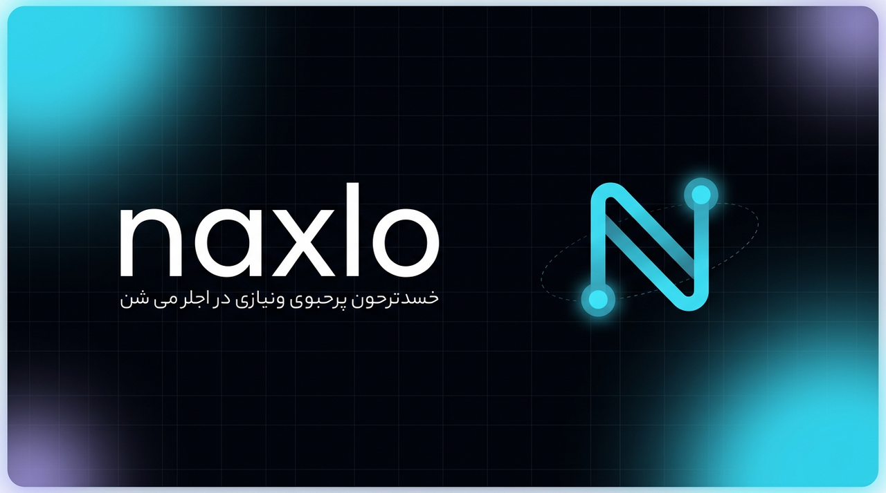

<div align="center">



# naxlo

**کلاینت فارسی‌زبان VLESS برای ویندوز — سبک، تاریک، با حالت TUN اختیاری**

Electron + React + Xray-core در حالت پروکسی محلی

[](https://github.com/Manixpcshot/Naxlo-tun/releases)
[](LICENSE)
[](https://github.com/Manixpcshot/Naxlo-tun/releases)
[](https://github.com/Manixpcshot/Naxlo-tun/actions)

</div>

---

ناکسلو یک کارگیر (کلاینت) دسکتاپ برای ویندوز است: لینک اشتراک را می‌گیرید، فایل TXT را دریافت و Base64 آن را
بازگشایی می‌کند، کانفیگ‌های VLESS را در یک فهرست زیبا نشان می‌دهد و با یک کلیک، هستهٔ Xray را در **حالت پروکسی
محلی** (SOCKS5 + HTTP روی `127.0.0.1`) اجرا می‌کند — بدون درایور و بدون دسترسی مدیر. از v1.6.0 یک **حالت TUN
اختیاری** هم وجود دارد: تونل کل‌سیستمی با اینباند TUN داخلی خود Xray و درایور رسمی Wintun (یک‌بار تأیید UAC)، برای
برنامه‌هایی که پروکسی ویندوز را نادیده می‌گیرند.

## ✨ ویژگی‌ها

| بخش | توضیح |
| --- | --- |
| 🔑 اشتراک | دریافت فایل TXT، بازگشایی Base64، تجزیهٔ `vless://` و `trojan://` و `vmess://` |
| 📁 فایل | وارد کردن کانفیگ از فایل‌های `txt/json/conf/sub` و **زیپ رمزدار** (پشتیبانی ZipCrypto با دریافت رمز از کاربر؛ در اندروید ZipCrypto و AES) |
| 🖥️ سرورها | فهرست زنده با جست‌وجو، فیلتر (REALITY/WS/gRPC)، تست تأخیر گروهی و مرتب‌سازی بر اساس سرعت |
| ⚡ اتصال | اجرای Xray با اینباندهای لوکال، تست واقعی عبور ترافیک، نمایش وضعیت، آی‌پی خروجی و مدت اتصال |
| 🧩 پروکسی سیستم | تنظیم خودکار پروکسی ویندوز (WinINET) و بازگردانی دقیق تنظیمات قبلی هنگام قطع |
| 🌐 حالت TUN | تونل اختیاری کل‌سیستمی با اینباند TUN داخلی Xray و درایور رسمی Wintun (پین SHA-256 + یک‌بار تأیید UAC) — حتی برنامه‌هایی که پروکسی را نادیده می‌گیرند |
| 🚪 خروج ایمن | هشدار سه‌گزینه‌ای هنگام بستن برنامه در حالت اتصال: «خاموش کن و ببند»، «متصل بمان و ببند» یا «لغو» (دسکتاپ و اندروید) |
| 🧠 هسته | دانلود خودکار Xray-core از مخزن رسمی + اعتبارسنجی SHA-512 + امکان انتخاب فایل دلخواه |
| 🔒 حریم خصوصی | خزانهٔ رمزنگاری‌شده (DPAPI)، نمایش پوشیدهٔ همهٔ مقادیر حساس، و **عدم ثبت هرگز** آن‌ها در لاگ |
| 🌙 طراحی | تم مشکی با یک رنگ تأکیدی، رابط کاملاً راست‌چین با قلم وزیرمتن و انیمیشن‌های نرم |

## 🧭 ناکسلو چگونه کار می‌کند؟

```
لینک اشتراک ──► دریافت TXT ──► بازگشایی Base64 ──► تجزیهٔ لینک‌ها (VLESS/…)
        │                                                     │
        ▼                                                     ▼
 خزانهٔ رمزنگاری‌شده ◄────────────────────────────── فهرست سرورها (نمایش پوشیده)
        │
        ▼
 انتخاب سرور ──► ساخت کانفیگ Xray ──► اجرای xray.exe (فرایند فرزند)
                                          │
                اینباند SOCKS5 :10808 ◄───┤
                اینباند HTTP   :10809 ◄───┘
                                          │
        (اختیاری) پروکسی سیستم ویندوز ◄───┘  ──► تست عبور ترافیک ──► وضعیت «متصل»
```

- **حالت پیش‌فرض (پروکسی):** ترافیک از دو اینباند لوکال عبور می‌کند؛ یا با پروکسی خودکار ویندوز، یا با تنظیم دستی
  هر برنامه روی آدرسهای بالا — بدون درایور و بدون دسترسی مدیر.
- **حالت TUN (اختیاری):** اینباند TUN داخلی Xray با درایور رسمی Wintun کل ترافیک سیستم را از تونل عبور می‌دهد —
  حتی برنامه‌هایی که پروکسی را نادیده می‌گیرند. یک‌بار تأیید UAC لازم است؛ پس از باز شدن مجدد، اتصال خودکار برقرار
  می‌شود و هنگام قطع، آداپتور و روت‌ها پاک می‌شوند.
- **کانفیگ Xray** در فایلی با دسترسی `0600` در پوشهٔ کاربر نوشته می‌شود و بلافاصله پس از خروج فرایند حذف می‌گردد.
- **مسیریابی:** سه حالت «همه از پروکسی»، «سایت‌های ایران مستقیم» و «شبکهٔ داخلی مستقیم» + مسدودسازی تبلیغات.

## 🔐 امنیت و حریم خصوصی

- لینک اشتراک، UUID/رمزها، کلید REALITY و آدرس سرورها داخل **خزانهٔ رمزنگاری‌شده** با `safeStorage` الکترون
  (روی ویندوز = DPAPI، متصل به حساب کاربری) ذخیره می‌شوند.
- همهٔ مقادیر حساس در رابط کاربری **پوشیده** نمایش داده می‌شوند و فقط با اقدام صریح کاربر («نمایش») آشکار می‌شوند.
- هر رشته‌ای که به لاگ می‌رود از یک **پالایگر (redactor)** عبور می‌کند: لینک‌ها، UUIDها، کلیدها و آدرس‌های شناخته‌شده
  با `[redacted]` جایگزین می‌شوند. لاگ دسترسی (access log) هسته هم خاموش است.
- پروکسی سیستم پیش از تغییر، پشتیبان‌گیری می‌شود و هنگام قطع اتصال یا خروج برنامه بازگردانی می‌گردد.
- هستهٔ Xray از ریلیز رسمی دانلود و با digest منتشرشده (SHA-512) اعتبارسنجی می‌شود.
- برنامه به دسترسی مدیر نیاز ندارد؛ فقط کلیدهای `HKCU` را برای پروکسی ویندوز می‌نویسد.

## 📦 نصب

از [صفحهٔ ریلیزها](https://github.com/Manixpcshot/Naxlo-tun/releases) یکی از دو خروجی را دریافت کنید:

- `Naxlo-Setup-x.x.x.exe` — نصب‌کنندهٔ NSIS (پیشنهادی)
- `Naxlo-Portable-x.x.x.exe` — نسخهٔ پرتابل، بدون نصب

هر دو خروجی همراه با هستهٔ Xray بسته‌بندی می‌شوند؛ اگر به هر دلیلی هسته همراه نبود، ناکسلو در نخستین اجرا آن را
به‌صورت خودکار دانلود و اعتبارسنجی می‌کند. فایل `SHA256SUMS.txt` در هر ریلیز برای کنترل یکپارچگی منتشر می‌شود.

> حداقل نیازمندی: ویندوز ۱۰/۱۱ (x64). هیچ درایور یا سرویسی نصب نمی‌شود.

## 🛠️ ساخت از سورس

```bash
git clone https://github.com/Manixpcshot/Naxlo-tun.git
cd Naxlo-tun
npm install

# دریافت هستهٔ Xray برای محیط توسعه (اختیاری؛ در غیر این صورت در نخستین اجرا دانلود می‌شود)
npm run xray:fetch

# اجرای حالت توسعه با هات‌ریلود
npm run dev

# تست‌ها و نوع‌بری
npm test
npm run typecheck

# بسته‌بندی نصب‌کنندهٔ ویندوز
npm run dist:win
```

خروجی‌ها در پوشهٔ `release/` ساخته می‌شوند. ریلیزهای رسمی با برچسب `v*` توسط workflow داخلی
(`.github/workflows/release.yml`) روی رانر ویندوز ساخته و به‌همراه checksum منتشر می‌شوند.

## 🧪 تست‌ها

ماژول‌های حساس (تجزیهٔ لینک، سازندهٔ کانفیگ Xray و پالایگر لاگ) بدون نیاز به الکترون تست می‌شوند:

```bash
npm test
```

این دستور تست‌ها را با Vite باندل کرده و با Node اجرا می‌کند؛ ورودی‌ها شامل لینک‌های واقعی VLESS با
TLS/WS/REALITY/Flow و موارد مرزی (لینک ناشناخته، REALITY بدون کلید، Base64 خراب) است.

## 🗂️ ساختار پروژه

```
src/
├─ main/            # فرایند اصلی الکترون
│  ├─ index.ts      # بوت‌استرپ، چرخهٔ حیات و پاک‌سازی هنگام خروج
│  ├─ state.ts      # منبع واحد وضعیت + پخش رویدادها
│  └─ lib/
│     ├─ secretStore.ts   # خزانهٔ رمزنگاری‌شده (DPAPI / AES-GCM)
│     ├─ redact.ts        # پالایگر لاگ
│     ├─ parseConfig.ts   # تجزیهٔ vless/trojan/vmess
│     ├─ subscription.ts  # دریافت و بازگشایی اشتراک
│     ├─ fileImport.ts    # وارد کردن از فایل + زیپ رمزدار (ZipCrypto)
│     ├─ systemProxy.ts   # پروکسی WinINET + بازگردانی
│     ├─ elevate.ts       # تشخیص دسترسی مدیر + باز شدن مجدد با UAC (حالت TUN)
│     └─ xray/            # core (دانلود/اعتبارسنجی)، config، runner، manager، wintun (درایور رسمی، پین SHA-256)
├─ preload/         # پل contextBridge با تایپ‌های مشترک
├─ renderer/        # رابط کاربری React (RTL، تم مشکی، انیمیشن با motion)
└─ shared/          # قراردادها و ماسک‌کننده‌های مشترک بین فرایندها
```

## 🤝 مشارکت

ایssue‌ها و Pull Request‌ها خوش‌آمدند. پیش از ارسال، `npm run typecheck` و `npm test` را اجرا کنید و
[CONTRIBUTING.md](CONTRIBUTING.md) و [SECURITY.md](SECURITY.md) را بخوانید.

## 📜 پروانه‌ها

- **ناکسلو:** [MIT](LICENSE)
- **Xray-core:** MPL-2.0 (باینری رسمی، بدون تغییر)
- **قلم وزیرمتن:** SIL OFL 1.1
- **Electron / React:** MIT

---

<div align="center">

**English summary** — Naxlo is a Persian (RTL), dark-themed Windows desktop client for VLESS subscriptions built
with Electron + React. It fetches a subscription TXT, decodes Base64, lists parsed configs, and runs the official
Xray core as a **local proxy** (SOCKS5 + HTTP on loopback, optional WinINET system proxy) by default, with an
optional **system-wide TUN mode** (Xray's built-in TUN inbound + the official, checksum-pinned Wintun driver, one-time
UAC elevation). Closing while connected always asks first: disconnect, stay connected, or cancel. Secrets live in an
encrypted vault, are masked in the UI and never logged. Installers are published on every tag via GitHub Actions with
SHA-256 checksums.

</div>
